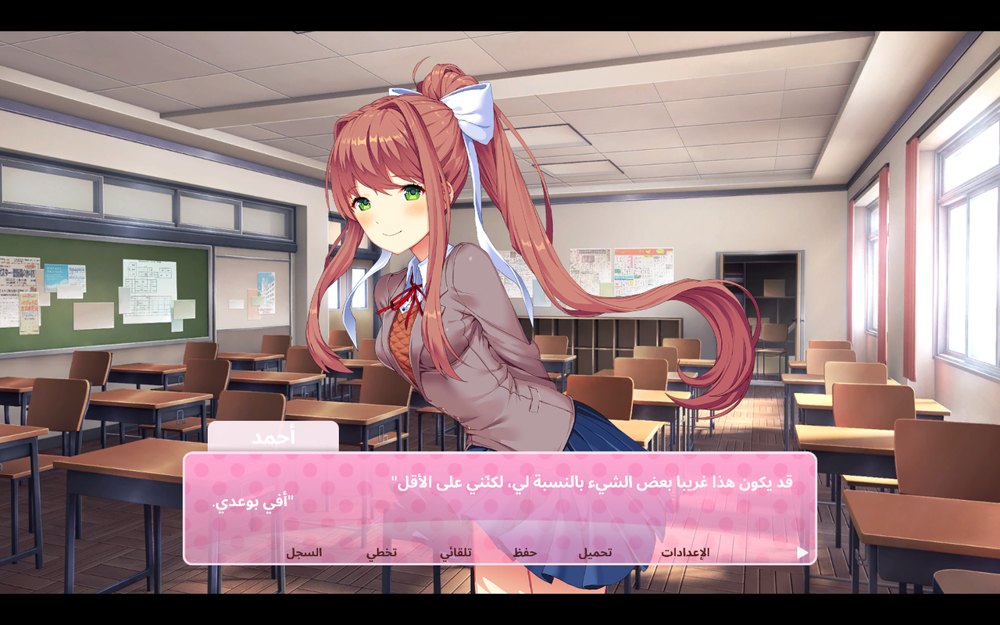
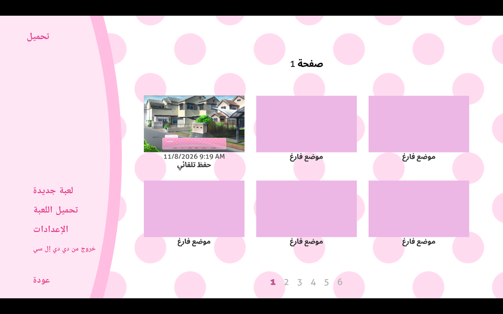

# تعريب Doki Doki Literature Club Plus إلى العربية

<div dir="rtl">

**ترجمة عربية كاملة، يدوية بالكامل، للعبة Doki Doki Literature Club Plus** (نسخة Steam على Windows).

تغطي الترجمة القصة الرئيسية بكل فصولها (Act 1–3)، والقصص الجانبية (Side Stories)،
وواجهة اللعبة وتطبيقات الحاسوب الداخلي (الملفات، البريد، الصور، الموسيقى، الإعدادات)،
ونصوص القصائد. الخطوط العربية مدمجة داخل أصول اللعبة، فلا حاجة لتثبيت أي خط على النظام.

### [⬇️ تحميل أحدث إصدار](../../releases/latest)

</div>

---

## ما الذي يشمله التعريب؟

| العنصر | التفاصيل |
|---|---|
| عدد النصوص المترجمة | **16,174** نصًا |
| عدد المشاهد | **226** مشهدًا |
| القصة الرئيسية | مترجمة كاملة (Act 1–3) |
| القصص الجانبية | مترجمة كاملة |
| الواجهة والتطبيقات | مترجمة (الملفات، البريد، الصور، الموسيقى، الإعدادات) |
| الخطوط | خطوط TMP عربية مدمجة مع وصل الحروف والتشكيل الصحيح |
| الترجمة الآلية | **لا يوجد أي نص مترجم آليًا** |

## لقطات من اللعب

<div dir="rtl">

**تبدأ اللعبة بالعربية مباشرة — بدون أي إعداد:**

<table>
  <tr>
    <td align="center"><br><sub>شاشة الدخول</sub></td>
    <td align="center"><br><sub>مركز اللعبة (الهَب)</sub></td>
  </tr>
</table>

**الحوار واسم اللاعب العربي:**

<table>
  <tr>
    <td align="center"><br><sub>اسم اللاعب «أحمد» يظهر مشكّلًا في شريط الاسم</sub></td>
    <td align="center"><br><sub>مشهد داخل الصف</sub></td>
  </tr>
</table>

**الاختيارات والشعر:**

<table>
  <tr>
    <td align="center"><br><sub>قائمة اختيار أثناء القصة</sub></td>
    <td align="center"><br><sub>كتابة القصيدة — الكلمات بالعربية</sub></td>
  </tr>
</table>

**الحفظ والإعدادات:**

<table>
  <tr>
    <td align="center"><br><sub>الحفظ التلقائي وخانات الحفظ</sub></td>
    <td align="center"><br><sub>الإعدادات كاملة بالعربية</sub></td>
  </tr>
</table>

**التطبيقات والقصص الجانبية:**

<table>
  <tr>
    <td align="center"><br><sub>القصص الجانبية</sub></td>
    <td align="center"><br><sub>تطبيق الملفات</sub></td>
  </tr>
  <tr>
    <td align="center"><br><sub>تطبيق الموسيقى</sub></td>
    <td align="center"><br><sub>اختيار اللغة «العربية»</sub></td>
  </tr>
</table>

</div>

## التثبيت

<div dir="rtl">

1. أغلق اللعبة إن كانت تعمل.
2. نزّل ملف الحزمة `DDLCPlus-Arabic-v1.1.0.zip` من صفحة [الإصدارات](../../releases/latest) وفك ضغطه في أي مكان.
3. شغّل **`install.bat`** بنقرتين (أو `install.ps1` من PowerShell).
4. سيكتشف المثبّت مجلد Steam تلقائيًا. إن لم يجده، ألصق مسار المجلد الذي يحتوي
   `Doki Doki Literature Club Plus.exe`، مثل:
   `C:\Program Files (x86)\Steam\steamapps\common\Doki Doki Literature Club Plus`
5. شغّل اللعبة — **تفتح بالعربية تلقائيًا من أول تشغيل** (حتى على ويندوز الإنجليزي).
   يمكنك تغيير اللغة متى شئت من: **الإعدادات ← اللغة**.

المثبّت يحتفظ بنسخة احتياطية من كل ملف أصلي داخل مجلد
`_DDLCPlus_Arabic_Backup` قبل استبداله.

</div>

## إزالة التعريب

<div dir="rtl">

شغّل **`restore.bat`** (أو `restore.ps1`) من نفس مجلد الحزمة؛ سيعيد كل الملفات الأصلية
من النسخة الاحتياطية ويحذف ملفات التعريب.

</div>

## التحقق من السلامة

<div dir="rtl">

بصمة ملف الحزمة المضغوطة (SHA-256):

```
4767b5f9c8a4bfc5234e756cfe9f08f5cb82c73f125b0d14cade7d4616eeb7f5  DDLCPlus-Arabic-v1.1.0.zip
```

وداخل الحزمة ملف `SHA256SUMS.txt` يحوي بصمات الملفات الثمانية بعد فك الضغط،
ويمكن التحقق منها على Windows بالأمر:

```powershell
Get-FileHash -Algorithm SHA256 -LiteralPath "files\...\langar.cy"
```

</div>

## الأسئلة الشائعة

<div dir="rtl">

**هل تحتوي الحزمة على اللعبة؟**
حزمة التعديل (patch) لا تحتوي اللعبة وتتطلب نسخة أصلية من Steam، لكن صفحة
[الإصدارات](../../releases/latest) تتضمن أيضًا **نسخة كاملة جاهزة** (اللعبة + التعريب
مدمجًا) تُفك وتُشغَّل مباشرة دون أي خطوات إضافية.

**هل يفقد التثبيت تقدمي أو حفظي؟**
لا. تُستبدل أصول اللعبة فقط (النصوص والخطوط)، مع نسخة احتياطية كاملة.

**هل توجد ترجمة آلية؟**
لا، كل النصوص مكتوبة ومراجعة يدويًا.

**هل يمكن كتابة اسم اللاعب بالعربية في شاشة إدخال الاسم؟**
نعم. يُعاد تشكيل الاسم ووصله تلقائيًا عند الكتابة وعند التأكيد، ويظهر موصولًا في الحوار
وفي شريط الاسم وسجل الحوار وشاشات الحفظ.

**حدّثت Steam اللعبة، فماذا أفعل؟**
قد يُلغي التحديث ملفات التعريب؛ أعد تشغيل `install.bat` بعد التحديث.

</div>

## الحقوق

<div dir="rtl">

هذا تعريب من صنع المعجبين. حقوق اللعبة ونصوصها الأصلية تعود إلى **Team Salvato**.
لا تتضمن هذه الحزمة أي ملفات من اللعبة الأصلية سوى أصول مُعدّلة لازمة للتعريب،
ولا يجوز استخدامها إلا مع نسخة أصلية مرخّصة من اللعبة.

</div>

---

<sub>Fan-made Arabic localization for Doki Doki Literature Club Plus (Windows/Steam). The patch contains no game content beyond modified localization assets and requires a legitimately owned copy of the game. All rights to the original game belong to Team Salvato.</sub>
