# نسخة معربة من دوكي دوكي بلس

<div dir="rtl">

**نسخة معربة كاملة من لعبة Doki Doki Literature Club Plus في ملف واحد.**

تغطي الترجمة القصة الرئيسية بكل فصولها (Act 1–3)، والقصص الجانبية (Side Stories)،
وواجهة اللعبة وتطبيقاتها الداخلية (الملفات، البريد، الصور، الموسيقى، الإعدادات)،
ونصوص القصائد. الخطوط العربية مدمجة داخل اللعبة نفسها.

### [⬇️ تحميل النسخة المعربة](../../releases/latest)

</div>

---

## ما الذي تشمله النسخة؟

| العنصر | التفاصيل |
|---|---|
| عدد النصوص المترجمة | **16,174** نصًا |
| عدد المشاهد | **226** مشهدًا |
| القصة الرئيسية | مترجمة كاملة (Act 1–3) |
| القصص الجانبية | مترجمة كاملة |
| الواجهة والتطبيقات | مترجمة (الملفات، البريد، الصور، الموسيقى، الإعدادات) |
| الخطوط | خطوط عربية مدمجة مع وصل الحروف والتشكيل الصحيح |
| الكتابة الآلية | تتكشّف من اليمين إلى اليسار، وترتيب الأسطر في الفقرات صحيح |
| أسماء اللاعبين | العربية مدعومة وتظهر متصلة بالاتجاه الصحيح |
| الترجمة الآلية | **لا يوجد أي نص مترجم آليًا** |

## طريقة التشغيل

<div dir="rtl">

1. نزّل الملف `DDLCPlus-Arabic-Full-v1.2.2.zip` من صفحة [الإصدارات](../../releases/latest).
2. فك ضغطه في أي مجلد (كليك يمين ← «استخراج الكل» — لا حاجة لأي برنامج إضافي).
3. افتح المجلد المستخرَج وشغّل **`Doki Doki Literature Club Plus.exe`**.
4. اللعبة تفتح **بالعربية مباشرة من أول تشغيل** وتعمل كل مراحلها بدون أي مشاكل.

</div>

## التحقق من السلامة

<div dir="rtl">

بصمة الملف (SHA-256):

```
5aeca35136e69fcba942ca25707fca59827621e8229e2a56f2bbf0d95997e55f  DDLCPlus-Arabic-Full-v1.2.2.zip
```

</div>

## لقطات من اللعب

<div dir="rtl">

**تبدأ اللعبة بالعربية مباشرة:**

<table>
  <tr>
    <td align="center">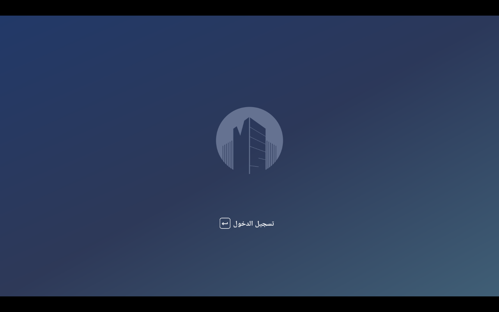<br><sub>شاشة الدخول</sub></td>
    <td align="center">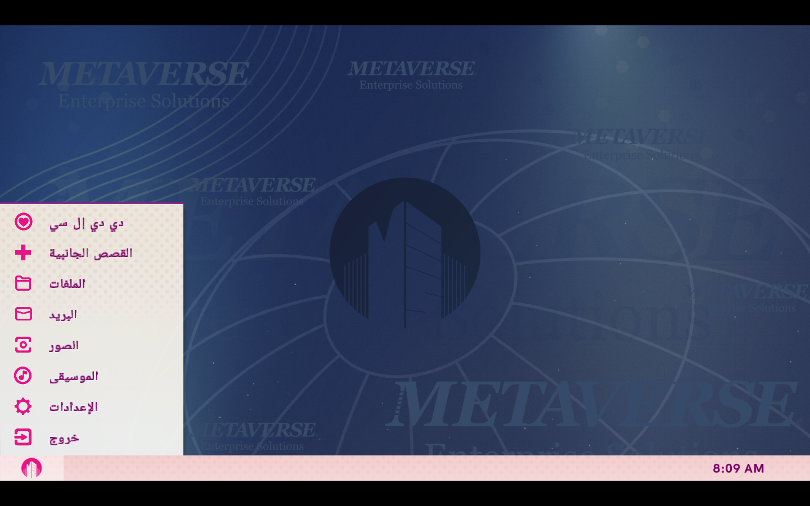<br><sub>مركز اللعبة (الهَب)</sub></td>
  </tr>
</table>

**الحوار واتجاه الكتابة والأسطر:**

<table>
  <tr>
    <td align="center">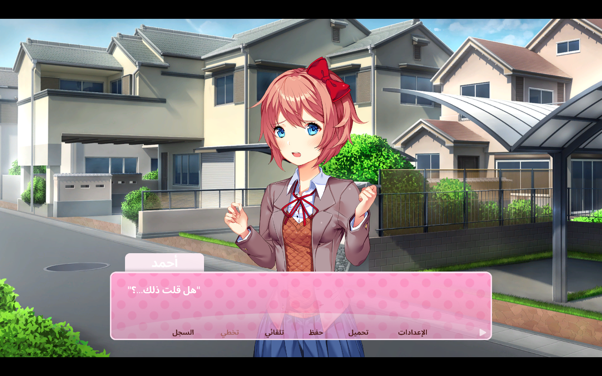<br><sub>اسم اللاعب العربي في شريط الاسم</sub></td>
    <td align="center"><br><sub>الكتابة الآلية من اليمين إلى اليسار</sub></td>
  </tr>
  <tr>
    <td align="center">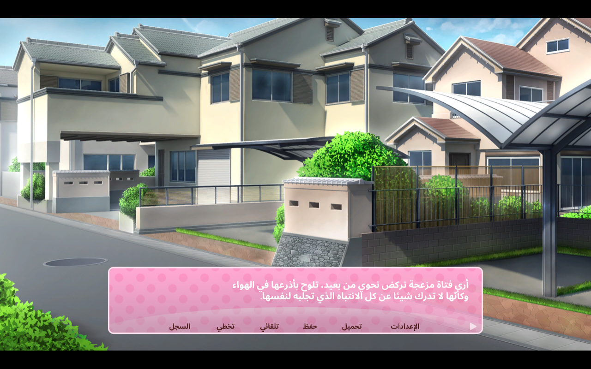<br><sub>فقرة من سطرين تبدأ من اليمين بالترتيب الصحيح</sub></td>
    <td align="center">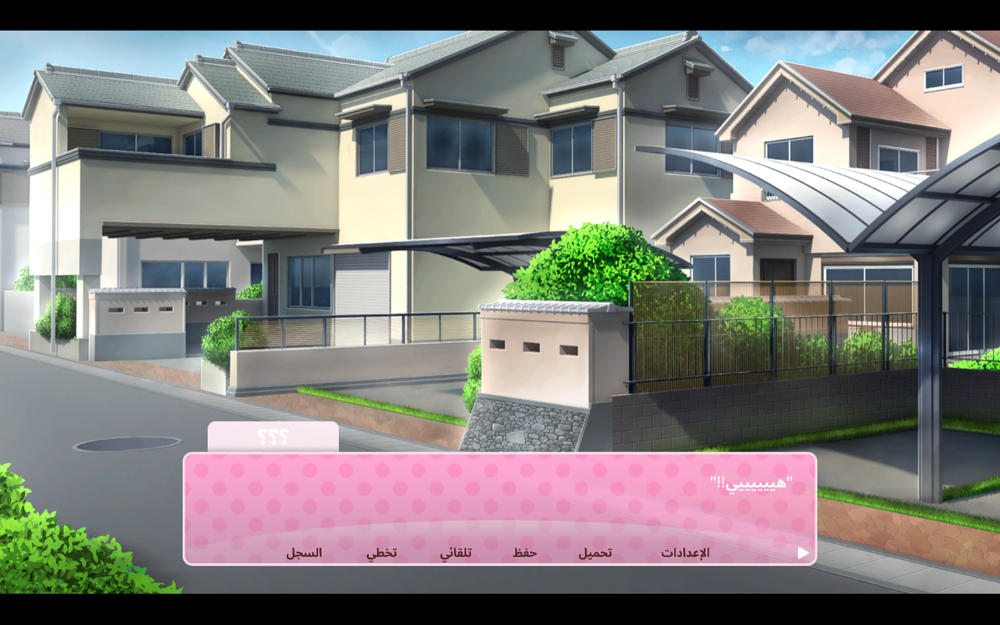<br><sub>سطر بين علامتي اقتباس محاذى لليمين</sub></td>
  </tr>
</table>

**الاختيارات والشعر والحفظ والإعدادات:**

<table>
  <tr>
    <td align="center">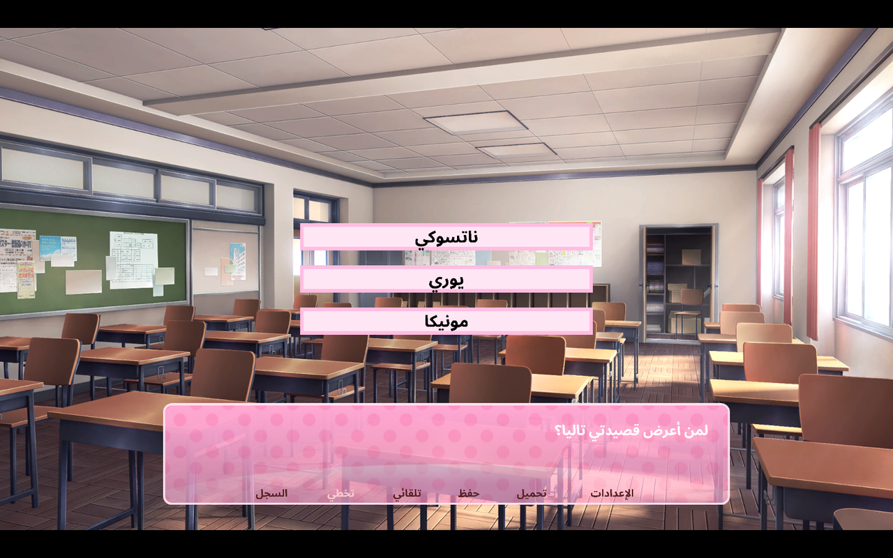<br><sub>قائمة اختيار أثناء القصة</sub></td>
    <td align="center">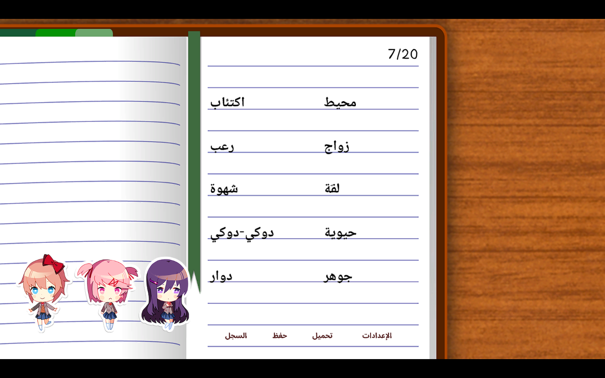<br><sub>كتابة القصيدة — الكلمات بالعربية</sub></td>
  </tr>
  <tr>
    <td align="center">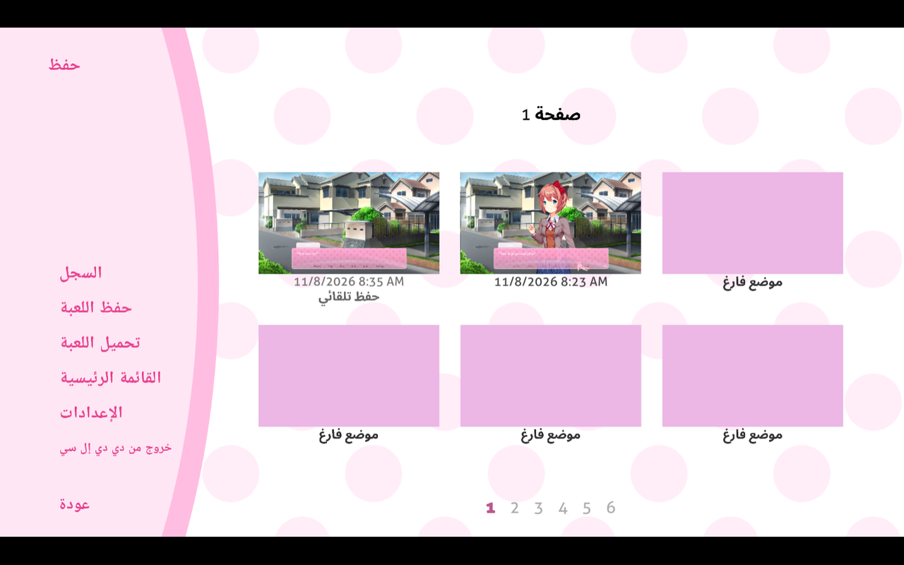<br><sub>شاشة الحفظ</sub></td>
    <td align="center">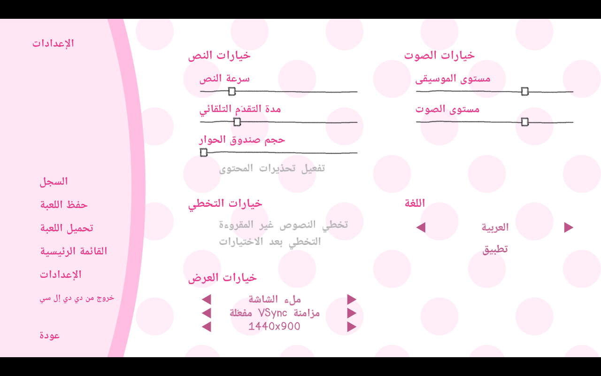<br><sub>الإعدادات كاملة بالعربية</sub></td>
  </tr>
</table>

**التطبيقات والقصص الجانبية:**

<table>
  <tr>
    <td align="center">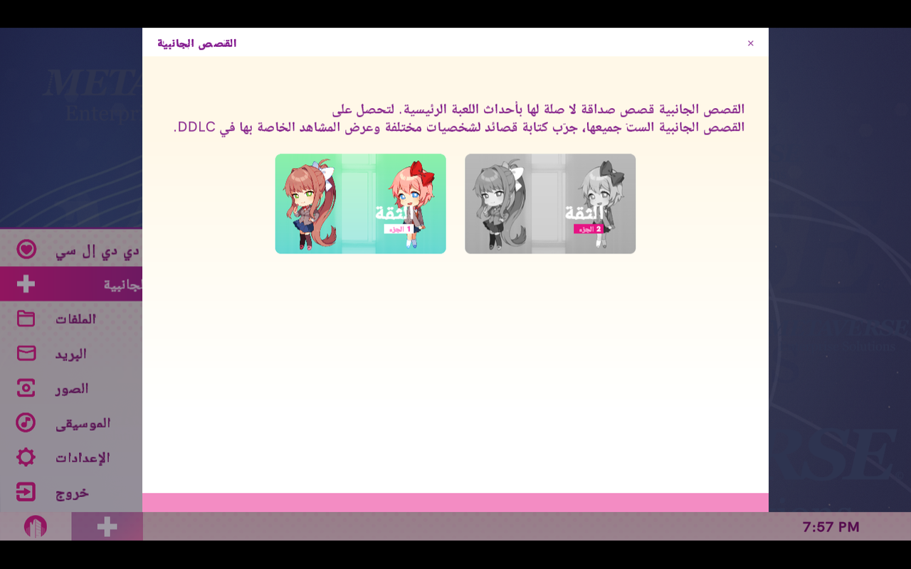<br><sub>القصص الجانبية</sub></td>
    <td align="center">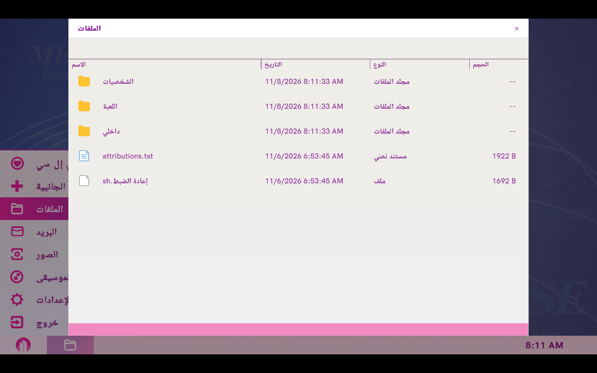<br><sub>تطبيق الملفات</sub></td>
  </tr>
  <tr>
    <td align="center">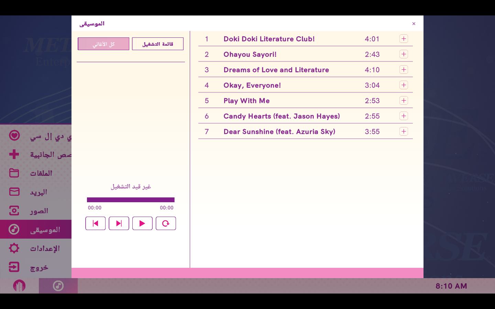<br><sub>تطبيق الموسيقى</sub></td>
    <td align="center">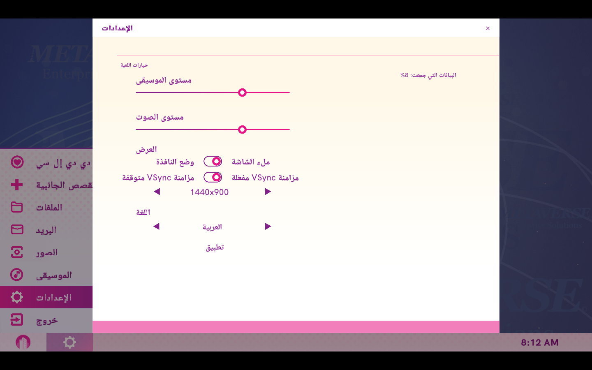<br><sub>اختيار اللغة «العربية»</sub></td>
  </tr>
</table>

</div>

## الأسئلة الشائعة

<div dir="rtl">

**كيف أشغّل اللعبة؟**
فك ضغط الملف وشغّل `Doki Doki Literature Club Plus.exe` — لا حاجة لأي إعداد أو تثبيت.

**هل اللعبة تعمل بالعربية من أول مرة؟**
نعم، تفتح بالعربية مباشرة.

**هل توجد ترجمة آلية؟**
لا، كل النصوص مكتوبة ومراجعة يدويًا.

**هل يمكن كتابة اسم اللاعب بالعربية؟**
نعم، ويظهر موصولًا بالاتجاه الصحيح في الحوار وشريط الاسم وسجل الحوار.

</div>

## الحقوق

<div dir="rtl">

هذا تعريب من صنع المعجبين. حقوق اللعبة ونصوصها الأصلية تعود إلى **Team Salvato**.

</div>

---

<sub>Fan-made Arabic localization for Doki Doki Literature Club Plus. All rights to the original game belong to Team Salvato.</sub>
